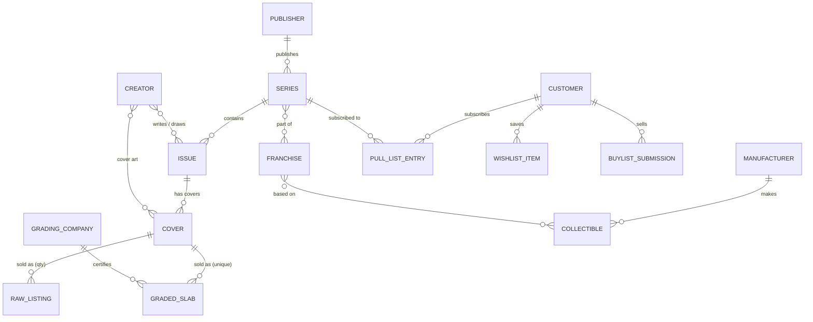

# 02 — Domain Model

> **Update — cards:** the store now also sells trading cards (Pokémon, One Piece) and sports cards (baseball, football, basketball), graded and raw, plus sealed product. Every product also carries a Department → Topic → Format classification, and the grading model is shared between comics and cards. See [10-cards-topics-and-showcases.md](10-cards-topics-and-showcases.md).

This doc models the business first, in its own language. It then maps each concept to Shopify primitives: Product, Variant, Collection, Metafield, Metaobject, Customer, Selling Plan.

## 1. Ubiquitous language

| Term | Meaning |
|---|---|
| **Issue** | A single published comic book (e.g. *Aurora Knights #1*). The creative work, independent of any copy. |
| **Series** | An ongoing or limited run of issues (*Aurora Knights*). |
| **Publisher** | Company that publishes series (Northfield, Orbital Press, Ironroot, Wayfarer Studios, Black Cove, Summit, Caps & Capes Comics). |
| **Creator** | Writer, artist or cover artist (*Kael Morwen*). |
| **Cover / Variant cover** | A specific cover of an issue (Cover A, 1:25 incentive, foil…). |
| **Raw copy** | An ungraded physical copy, sold in quantity. |
| **Slab / Graded copy** | A copy that a grading company (CGC, CBCS, PGX) has graded and encapsulated. **Each slab is unique** (it has a certification number). |
| **Grade** | Numeric condition 0.5–10.0, plus page quality (*White Pages*) and label type (*Universal, Signature, Restored, Qualified*). |
| **Key issue** | An issue that matters to collectors (first appearance, origin, death, iconic cover). Carries "key notes". |
| **Collectible** | Non-comic merchandise: statues, busts, enamel pins, prints. |
| **Action figure** | An articulated figure, a sub-type of collectible with its own nav entry. |
| **Preorder** | A listing for an item not yet released, sold before its release date. |
| **New This Week** | Items whose release date falls in the current week (comic "New Comic Book Day" is Wednesday). |
| **Pull list** | A customer's standing subscription to series. New issues are reserved or ordered for them automatically. |
| **Sell To Us / Buylist** | Customer sells their collection to the store, often for store credit. |

## 2. Conceptual model



### Aggregates and their boundaries

1. **Catalog (sellables):** `RawListing`, `GradedSlab`, `Collectible`. These are things with a price and stock, so they become **Shopify Products**.
2. **Reference data:** `Publisher`, `Series`, `Issue`, `Creator`, `GradingCompany`, `Manufacturer`, `Franchise`. These describe sellables but are never bought, so they become **Shopify Metaobjects**.
3. **Customer relationships:** `PullList`, `Wishlist`, `BuylistSubmission`. Per-customer state, stored in **customer metafields, apps, or Shopify Forms** (see doc 07).

> Design decision: **`Issue` is a metaobject, not a product.** One issue (*Aurora Knights #1*) can be sold as a raw copy at $4.99 and as several slabs at $54.99–$89.99. Making the Issue the shared reference lets the PDP show "Other copies of this issue" and lets the pull list work at the series/issue level.

## 3. Mapping to Shopify

### 3.1 Product types (Shopify `product_type`) and templates

| Domain type | `product_type` | Template | Variants | Inventory |
|---|---|---|---|---|
| Raw comic | `Comic` | `product.comic.json` | Optional: cover (A/B/1:25) **or** condition (NM/VF) | Tracked, qty N |
| Graded slab | `Graded Comic` | `product.graded.json` | None (single default variant) | Tracked, qty 1, `continue selling = off` |
| Statue / bust / pin / print | `Collectible` | `product.collectible.json` | Optional: edition (Standard / Exclusive) | Tracked |
| Action figure | `Action Figure` | `product.collectible.json` | Optional | Tracked |

**Preorder is a state, not a type.** Any product can be on preorder. The state comes from a `custom.release_date` in the future plus a selling plan or preorder app flag. Collections and badges read that state.

### 3.2 Metaobject definitions (reference data)

| Metaobject | Handle | Fields (key: type) | Web page? |
|---|---|---|---|
| **Publisher** | `publisher` | `name: single_line_text`, `logo: file_reference (svg/png)`, `description: rich_text`, `founded_year: number_integer`, `featured: boolean`, `sort_order: number_integer` | Yes → `/pages/publishers/{handle}` (metaobject web template) |
| **Series** | `series` | `title: single_line_text`, `publisher: metaobject_reference<publisher>`, `status: single_line_text (choices: Ongoing, Limited, Completed)`, `synopsis: rich_text`, `hero_image: file_reference`, `franchise: metaobject_reference<franchise>` | Yes → series landing page |
| **Issue** | `issue` | `series: metaobject_reference<series>`, `number: single_line_text` ("1", "1.MU", "Annual 1"), `title: single_line_text`, `release_date: date`, `page_count: number_integer`, `upc: single_line_text`, `writers: list.metaobject_reference<creator>`, `artists: list.metaobject_reference<creator>`, `synopsis: rich_text`, `is_key: boolean`, `key_notes: list.single_line_text` | No (rendered via product) |
| **Creator** | `creator` | `name`, `roles: list.single_line_text`, `bio: rich_text`, `portrait: file_reference` | Optional |
| **Grading company** | `grading_company` | `name` ("CGC"), `full_name`, `logo`, `about: rich_text` (feeds the "CGC Information" tab), `census_url_template: url`, `cert_lookup_url_template: url`, `grade_scale: json` | No |
| **Manufacturer** | `manufacturer` | `name`, `logo`, `website: url` | No |
| **Franchise** | `franchise` | `name`, `logo`, `hero_image` | Yes (optional) |
| **Trust point** | `trust_point` | `icon: single_line_text (choices)`, `title`, `caption` | No (used by homepage + PDP trust strips) |

### 3.3 Product metafields

Namespace `comic` (all comic products):

| Key | Type | Example | Rendered at |
|---|---|---|---|
| `comic.issue` | `metaobject_reference<issue>` | Aurora Knights #1 | Title line, spec table, related copies |
| `comic.cover_label` | `single_line_text` | "Cover A – Kael Morwen" | Spec table |
| `comic.cover_artist` | `metaobject_reference<creator>` | Kael Morwen | Highlights list |
| `comic.highlights` | `list.single_line_text` | "First issue in the ongoing series" | Description bullets |
| `comic.print_run` | `single_line_text` | "Limited initial print run" | Key details tab |

Namespace `grading` (graded slabs only):

| Key | Type | Example |
|---|---|---|
| `grading.company` | `metaobject_reference<grading_company>` | CGC |
| `grading.grade` | `number_decimal` (0.5–10.0) | 9.8 |
| `grading.grade_label` | `single_line_text` (choices) | "Top Tier Grade", "Near Mint/Mint" |
| `grading.page_quality` | `single_line_text` (choices) | White Pages |
| `grading.label_type` | `single_line_text` (choices) | Universal, Signature Series, Restored, Qualified |
| `grading.cert_number` | `single_line_text` | 4012345001 |
| `grading.graded_date` | `date` | 2024-06-01 |
| `grading.slab_images` | `list.file_reference` | front / back / label close-ups (or just use product media) |

Namespace `collectible` (collectibles & figures):

| Key | Type |
|---|---|
| `collectible.manufacturer` | `metaobject_reference<manufacturer>` |
| `collectible.franchise` | `metaobject_reference<franchise>` |
| `collectible.scale` | `single_line_text` ("1:6", "1:10") |
| `collectible.dimensions` | `dimension` (height) |
| `collectible.material` | `single_line_text` (Polystone, PVC, Enamel) |
| `collectible.edition_size` | `number_integer` |
| `collectible.whats_in_the_box` | `list.single_line_text` |

Namespace `custom` (cross-cutting):

| Key | Type | Purpose |
|---|---|---|
| `custom.release_date` | `date` | Drives New This Week, Preorders, and "Release Date" in the spec table. Copied from `issue.release_date` for comics by Flow, so smart collections/filters work on the product. |
| `custom.publisher` | `metaobject_reference<publisher>` | Copied from issue → series → publisher, so Search & Discovery can filter by publisher |
| `custom.is_key` | `boolean` | Denormalised for the Key Issues collection and its filter |
| `custom.short_title` | `single_line_text` | Card line 2 (e.g. "#1 CGC 9.8") when the title needs splitting |
| `custom.featured_badge` | `single_line_text` (choices) | "Staff Pick", "Exclusive", "Low Print" |

Standard Shopify metafields:
- `reviews.rating`, `reviews.rating_count` (written by the reviews app) → stars on PDP and cards.
- `shopify.*` category metafields from the Shopify Standard Product Taxonomy (category: *Media > Books > Comics & Graphic Novels*, *Toys > Action Figures*, etc.) → better Shop/Google listings.

> Why denormalise `release_date`, `publisher` and `is_key` onto the product? Smart collection rules and Search & Discovery filters work on **product** fields and metafields. They cannot follow nested metaobject references. Flow keeps the copies in sync (see doc 07 §Automation).

### 3.4 Title convention

Product titles follow a strict, parseable pattern, so cards can split them the way the mockup shows:

```
{Series} #{Number} [{Cover label}] [{Company} {Grade}]
Aurora Knights #1 CGC 9.8
Eclipse Chronicles #1
Silent Oath #1 Cover B CGC 9.6
The Wanderer Statue
```

The card snippet renders `series` on line 1 and `#number + grade` on line 2. It reads these from metafields when present, and falls back to the full title.

### 3.5 Tags (operational only)

Use tags only for operations and automation, never for display data: `new-this-week`, `preorder`, `featured-home`, `exclusive`, `restock`. Display data lives in metafields.

### 3.6 Collections

| Collection | Type | Rule |
|---|---|---|
| New This Week | Smart | tag = `new-this-week` (tag managed weekly by Flow from `custom.release_date`) |
| Comics | Smart | product_type = `Comic` OR `Graded Comic` |
| Raw Comics | Smart | product_type = `Comic` |
| Key Issues | Smart | metafield `custom.is_key` = true |
| Graded Comics | Smart | product_type = `Graded Comic` |
| CGC 9.8 | Smart | type = Graded Comic AND metafield `grading.grade` = 9.8 *(or tag fallback)* |
| Collectibles | Smart | product_type = `Collectible` OR `Action Figure` |
| Statues & Busts / Pins / Prints | Smart | product_type + tag or `shopify` category |
| Action Figures | Smart | product_type = `Action Figure` |
| Preorders | Smart | tag = `preorder` (managed by Flow / preorder app) |
| Featured This Week | Manual | merchant-curated, feeds the homepage carousel |
| Per-publisher | Smart | metafield `custom.publisher` = {publisher}. Or use the publisher metaobject page with a filtered product query. |

> Verify which metafield types smart-collection conditions support in the admin at build time. If a type isn't supported (e.g. metaobject reference), fall back to a Flow-managed tag such as `publisher:northfield`.

### 3.7 Customer-side model

| Concept | Storage | Notes |
|---|---|---|
| Wishlist | App (v1) **or** `customer.metafields.custom.wishlist: list.product_reference` | Needs write access from the storefront. Writing a customer metafield needs an app proxy or Customer Account API, so buying an app is simpler for v1. |
| Pull list | `customer.metafields.pull_list.series: list.metaobject_reference<series>` + `pull_list.preferences: json` (cover pref, qty) | Custom app (Phase 2), see doc 07 |
| Store credit | Native Shopify store credit accounts | Shown on the account page; used for Sell To Us payouts |
| Collector tier | `customer.metafields.custom.tier` or customer tags | Optional loyalty |

### 3.8 Invariants (rules the system must enforce)

1. A `Graded Comic` product has exactly one variant, inventory ≤ 1, and a non-empty `grading.company`, `grading.grade` and `grading.cert_number`.
2. A `Comic`/`Graded Comic` product must reference an `issue`, and that issue must reference a series with a publisher.
3. A product with `custom.release_date > today` is a **preorder**. It must have a selling plan or preorder flag, and must not show "In stock".
4. `custom.publisher`, `custom.is_key` and `custom.release_date` always match their source issue (Flow sync + a nightly audit).
5. The cert number is unique across products. This can't be enforced natively: run an admin bulk check before publishing, plus a Flow "duplicate cert" alert.

These rules become an **import validator** (a Python script against a CSV/Admin API, Phase 1) and Flow alerts.
