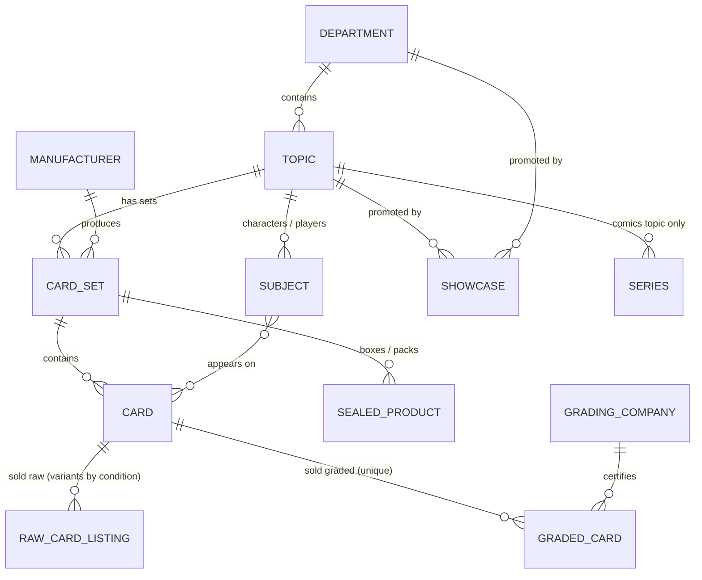

# 10 — Cards, Topics & Showcases

This doc widens the store from comics-first to **comics + trading cards + sports cards**, each sold **graded or ungraded (raw)**, plus sealed product. It adds three ideas:

1. **Department → Topic → Format**: one classification that every product carries, so comics and cards can share a homepage and still get their own hub pages.
2. **Topic hubs**: one reusable page template that renders *Comics*, *Pokémon*, *One Piece*, *Baseball*, *Football* or *Basketball* from data, not from separate hand-built pages.
3. **Showcases**: managed banner/headline content with images, scheduling and placement, so marketing can change hero art without touching the theme.

Designs: [design canvas → "Comics + Cards (v2)" page](https://claude.ai/artifact/TTwTtAxNgNn18a9Syo2g8w).
This doc **extends** [02-domain-model.md](02-domain-model.md) and **supersedes** the navigation in [03-information-architecture.md](03-information-architecture.md) §1.

---

## 1. Ubiquitous language (additions)

| Term | Meaning |
|---|---|
| **Department** | Top-level business line: `Comics`, `Trading Cards` (TCG), `Sports Cards`, `Collectibles`. Drives the main nav. |
| **Topic** | A fan-facing "world" inside a department with its own hub page: Comics · Pokémon · One Piece · Baseball · Football (NFL) · Basketball (NBA). New topics (e.g. Magic, Lorcana, Hockey, Soccer) are added as **data**, not code. |
| **Format** | How the item is sold: `Graded` (slabbed, unique), `Raw` (ungraded singles, stocked by condition), `Sealed` (booster box, ETB, hobby box, pack), `Merch` (statues, figures, supplies). |
| **Card set** | A release: *Base Set*, *Scarlet & Violet — 151*, *OP-01 Romance Dawn*, *2023 Topps Chrome*. Has a game/sport, year, manufacturer and set code. |
| **Card** | The reference card, independent of any copy: set + number + subject + variant/parallel. |
| **Subject** | Who's on the card: a character (*Charizard*, *Monkey D. Luffy*) or a player. |
| **Parallel / variant** | Print variation: Holo, Reverse Holo, 1st Edition, Alt Art, Manga Rare, Refractor, Prizm Silver, /99 numbered. |
| **Rookie (RC)** | A player's first-year card. The sports equivalent of a comic "key issue". |
| **Auto / Relic** | Autographed card / card with embedded memorabilia (patch, jersey). |
| **Serial-numbered** | Limited print run stamped on the card (`23/99`). |
| **Card grading company** | PSA, BGS (Beckett), SGC, CGC Cards, TAG. Card grades run 1–10. BGS (and some others) add **subgrades**: centering, corners, edges, surface. A BGS 10 with all four subgrades at 10 is a **Black Label**. |
| **Raw condition** | Ungraded card condition: `NM` Near Mint · `LP` Lightly Played · `MP` Moderately Played · `HP` Heavily Played · `DMG` Damaged. |
| **Population (pop)** | How many copies the grading company has graded at that grade. A selling point ("Pop 12, none higher"). |
| **Grail / Chase** | A topic's headline high-value cards. Merchandised in their own row. |
| **Showcase** | A managed banner: image + headline + CTA, placed in a slot (home hero, topic hero, inline strip…), optionally scheduled. |

## 2. Conceptual model



The comic and card models are **parallel**:

| Comics | Cards | Shared concept |
|---|---|---|
| Publisher | Manufacturer | Who made it |
| Series | Card set | The release |
| Issue | Card | The reference work (metaobject, never sold) |
| Raw comic | Raw card (variants = condition) | Ungraded copies, quantity-tracked |
| Graded comic (slab) | Graded card (slab) | Unique, qty 1, has a cert number |
| — | Sealed product | Unopened product, quantity-tracked |
| Key issue | Rookie / Chase / 1st Edition | The "why it matters" flag |

Because both sides share **Format** and **Grading**, one grading model, one slab card component and one "graded vault" collection serve both.

## 3. Mapping to Shopify

### 3.1 Product types & templates

| Domain type | `product_type` | Template | Variants | Inventory |
|---|---|---|---|---|
| Raw comic | `Comic` | `product.comic` | cover/condition | qty N |
| Graded comic | `Graded Comic` | `product.graded` | none | qty 1 |
| **Raw card** | `Raw Card` | `product.card` | **Condition** (NM / LP / MP / HP / DMG), plus optional **Language** (EN / JP) | qty N per variant |
| **Graded card** | `Graded Card` | `product.graded-card` | none | qty 1 |
| **Sealed** | `Sealed` | `product.sealed` | optional (box / case) | qty N |
| Collectible / figure | `Collectible` / `Action Figure` | `product.collectible` | edition | qty N |
| Supplies | `Supplies` | `product.collectible` | size / pack count | qty N |

### 3.2 New metaobject definitions

| Metaobject | Fields (key: type) | Web page? |
|---|---|---|
| **department** | `name`, `handle`, `nav_order: number_integer`, `topics: list.metaobject_reference<topic>` | No (it's the nav) |
| **topic** | `name` ("Pokémon"), `short_name` ("Pokémon"), `department: metaobject_reference<department>`, `accent_color: color`, `icon: file_reference (svg)`, `tagline`, `intro: rich_text`, `hero_showcases: list.metaobject_reference<showcase>`, `inline_showcase: metaobject_reference<showcase>`, `featured_sets: list.metaobject_reference<card_set>` (or `featured_series` for comics), `formats_enabled: list.single_line_text (Graded, Raw, Sealed, Merch)`, `default_format`, `filter_profile: single_line_text (choices: tcg, sports, comics)`, `grails_collection: collection_reference`, `guide_articles: list.article_reference`¹ , `trust_points: list.metaobject_reference<trust_point>`, `seo_title`, `seo_description` | Linked from the topic collection (§3.5) |
| **card_set** | `name`, `topic: metaobject_reference<topic>`, `manufacturer: metaobject_reference<manufacturer>`, `code` ("OP01"), `year: number_integer`, `release_date: date`, `era: single_line_text (Vintage, Modern, Ultra-modern)`, `language`, `logo: file_reference`, `hero_image: file_reference`, `card_count: number_integer` | Yes → `/pages/card_set/{handle}` (optional) |
| **card** | `set: metaobject_reference<card_set>`, `number` ("4/102", "OP01-120", "150"), `subject: metaobject_reference<subject>`, `subject_name` (denormalised for search), `variant` ("Holo", "Alt Art", "Refractor"), `rarity`, `is_rookie: boolean`, `is_auto: boolean`, `is_relic: boolean`, `serial_run: number_integer` (99 for /99), `first_edition: boolean`, `image: file_reference` | No |
| **subject** | `name`, `kind: single_line_text (Character, Player)`, `topic: metaobject_reference<topic>`, `team` (players), `position` (players), `portrait: file_reference` | Optional (player pages later) |
| **showcase** | see §5 | No |

¹ `article_reference` is listed as a metafield type in recent Shopify releases. If it isn't available on the store, use `list.url` or a blog-tag convention.

The existing **manufacturer** metaobject (doc 02) now covers card makers too (Topps, Panini, Upper Deck, Bowman, Bandai, The Pokémon Company). The existing **grading_company** metaobject gains: `applies_to: list (Comics, Cards)`, `has_subgrades: boolean`, `grade_labels: json` (e.g. `{"10": "GEM MT", "9": "MINT"}`), `pop_report_url_template: url`.

### 3.3 Product metafields (additions)

Cross-cutting classification (namespace `catalog`). **Every product** carries it. It's the backbone for nav, hubs, filters and counts:

| Key | Type | Example |
|---|---|---|
| `catalog.department` | `metaobject_reference<department>` | Trading Cards |
| `catalog.topic` | `metaobject_reference<topic>` | Pokémon |
| `catalog.format` | `single_line_text` (choices: Graded, Raw, Sealed, Merch) | Graded |
| `catalog.is_chase` | `boolean` | true (Rookie / Key / Grail flag, normalised across departments) |
| `catalog.release_date` | `date` | replaces `custom.release_date` (keep the old key as an alias during migration) |

Card-specific (namespace `card`):

| Key | Type | Notes |
|---|---|---|
| `card.ref` | `metaobject_reference<card>` | The reference card |
| `card.set_name`, `card.year`, `card.subject_name` | text / integer | Denormalised for filters and search (Search & Discovery can't filter through references) |
| `card.variant` | `single_line_text` | Holo, Alt Art, Refractor… (filter) |
| `card.attributes` | `list.single_line_text` (choices: Rookie, Auto, Relic, Serial-numbered, 1st Edition) | Filter and badges |
| `card.serial_number` | `single_line_text` | "23/99", per copy |
| `card.language` | `single_line_text` (EN, JP, …) | Filter. For raw singles it's a variant option instead. |

Grading (namespace `grading`, now shared by comics and cards):

| Key | Type | Notes |
|---|---|---|
| `grading.company`, `grading.grade`, `grading.cert_number`, `grading.label_type` | as doc 02 | |
| `grading.grade_label` | text | "GEM MT 10", "PRISTINE 10", "BLACK LABEL" |
| `grading.subgrades` | `json` | `{"centering": 9.5, "corners": 9.5, "edges": 10, "surface": 9.5}`. Absent for PSA. |
| `grading.auto_grade` | `number_decimal` | Autograph grade on dual-graded slabs |
| `grading.population`, `grading.pop_higher` | `number_integer` | Optional, entered at intake; show "Pop 12 · 0 higher" |
| `grading.page_quality` | text | Comics only |

### 3.4 Title & SKU conventions

```
Graded TCG    {Year} {Set} {Subject} #{Number} {Variant} {Company} {Grade}
              1999 Pokémon Base Set Charizard #4 Holo PSA 9
Graded sports {Year} {Brand} {Set} {Player} #{Number} {Parallel} {RC} {Auto} {/Serial} {Company} {Grade}
              2023 Topps Chrome [Player] #150 Refractor RC Auto /99 BGS 9.5
Raw card      {Set} {Subject} #{Number} {Variant}          (condition & language are variants)
              OP-01 Romance Dawn Monkey D. Luffy OP01-120 Alt Art
Sealed        {Set} {Product}                               Scarlet & Violet 151 Booster Bundle
```

SKU: `{DEPT}-{TOPIC}-{FORMAT}-{ID}`:
- `TCG-PKM-GR-{cert}` (graded: the cert number makes it unique)
- `TCG-OP-RAW-OP01120-NM-EN` (raw: card + condition + language)
- `SPT-BSB-SLD-{upc}` (sealed)
- `CMX-CMX-GR-{cert}` (comics)

Cards render titles in 3 lines: **subject** (line 1, condensed UPPER), **year · set · #** (line 2, muted), **grade chip** (line 3). Titles are built from metafields, so the long Shopify title can stay SEO-friendly.

### 3.5 Collections & topic pages

| Collection (handle) | Rule | Template |
|---|---|---|
| `comics`, `trading-cards`, `sports-cards`, `collectibles` | tag `dept:{handle}` | `collection.department` (lists its topics + mixed grid) |
| `pokemon`, `one-piece`, `baseball`, `football`, `basketball`, `comics-hub`² | tag `topic:{handle}` | **`collection.topic`** |
| `{topic}-graded`, `{topic}-raw`, `{topic}-sealed`, `{topic}-preorders` | tag `topic:{handle}` AND tag `format:{x}` AND **inventory stock > 0** | `collection` (standard grid, topic filters) |
| `graded` ("The Vault") | tag `format:graded` AND inventory > 0 | `collection.graded` (all departments, department tabs) |
| `{topic}-grails` | manual | used by the topic page's "Grails" carousel |
| `new-arrivals` | tag `new-arrival` (Flow: created/listed in the last 7 days) | `collection` (department tabs) |

² The comics topic page can reuse the `comics` collection with the `collection.topic` template.

**Topic pages are collections** (`/collections/pokemon`) using the `collection.topic` template. The collection has a metafield `custom.topic → topic metaobject`, and the template reads hero showcases, sets, format counts, grails and guides from it. Why collections rather than pages:
- They get real product URLs, facets, sorting and pagination for free.
- They're good for SEO ("Pokémon cards" lands on a page that actually lists products).
- Adding a topic = create a metaobject + 5 collections (scripted), with no theme work.

**Tags vs metafields:** collection rules can't follow metaobject references, so Flow writes the mirror tags `dept:*`, `topic:*` and `format:*` from the `catalog.*` metafields on every product create/update (same pattern as doc 02 §3.6).

### 3.6 "Selection availability": how counts work

The homepage availability matrix and topic format tabs show **live in-stock counts**:

```liquid

{{ c.products_count }} graded
```

- Each count collection includes the smart rule **inventory stock > 0**. Sold slabs drop out automatically, so the number always means "available now".
- `products_count` counts products, not units. That's right for slabs (1 product = 1 item). For raw singles it reads as "N different cards", so label it "singles", not "cards in stock".
- Count is 0 → render "Coming soon" + a "Notify me" link (newsletter tag `interest:{topic}-{format}`), never "0".
- Counts above 999 display as "1.2k".

### 3.7 Invariants (additions to doc 02 §3.8)

1. Every product has `catalog.department`, `catalog.topic` and `catalog.format`, and the matching tags. The import validator rejects products without them.
2. `Graded Card`: exactly one variant, qty ≤ 1, `grading.company`, `grading.grade` and `grading.cert_number` set, and front + back images (≥ 2 media).
3. `Raw Card`: the variant option "Condition" uses only the NM/LP/MP/HP/DMG values. Each variant has its own SKU and price.
4. If `grading.company.has_subgrades` and subgrades are present, all four keys exist.
5. The cert number is unique across **all** graded products (comics and cards).

## 4. Navigation & IA (replaces doc 03 §1)

| Label | Target | Mega menu columns |
|---|---|---|
| NEW ARRIVALS | `/collections/new-arrivals` | — |
| COMICS ▾ | `/collections/comics` | Shop comics (New releases, Back issues, Key issues, Graded, Variants) · Popular series · Publishers · showcase tile |
| TRADING CARDS ▾ | `/collections/trading-cards` | **Per topic** (Pokémon, One Piece): Graded · Raw singles · Sealed · Preorders · Featured sets · showcase tile |
| SPORTS CARDS ▾ | `/collections/sports-cards` | Baseball · Football · Basketball, each with Graded / Raw / Hobby boxes · Rookies · Autographs · showcase tile |
| GRADED ▾ | `/collections/graded` | The Vault by department: Comics (CGC/CBCS), Pokémon, One Piece, Sports (PSA/BGS/SGC) · Grade 10s · Under $100 |
| COLLECTIBLES ▾ | `/collections/collectibles` | Statues, Busts, Figures, Pins, Supplies |
| PREORDERS | `/collections/preorders` | — |
| SELL TO US | `/pages/sell-to-us` | — |

Changes from the approved desktop mockup: "Key Issues" moves into the Comics menu, "Graded Comics" becomes the cross-category **Graded** vault, and "Action Figures" merges into Collectibles. That frees two slots for the card departments while keeping 8 items, the same width as the mockup.

Mega menu content (topic lists, set tiles, showcase tile) comes from the `department` and `topic` metaobjects, so a new topic appears in the nav without code.

## 5. Showcases: banner & headline management

### 5.1 Model (`showcase` metaobject)

| Field | Type | Notes |
|---|---|---|
| `internal_name` | text | "Home hero — OP-09 preorder" |
| `placement` | choices: `home_hero`, `home_split`, `home_strip`, `topic_hero`, `topic_inline`, `mega_menu_tile`, `collection_banner` | The slot it's designed for. Determines the image specs below. |
| `topic` | `metaobject_reference<topic>` | Optional. Empty = global. Used for the accent glow + eyebrow default. |
| `eyebrow` | text (≤ 40 chars) | "TRADING CARDS · ONE PIECE" |
| `headline` | text (≤ 40 chars, 2 lines max) | "Romance Dawn. Graded & raw." |
| `subheadline` | text (≤ 120 chars) | |
| `cta_label`, `cta_link` | text, `url` (or `collection_reference`) | Primary CTA (amber) |
| `cta2_label`, `cta2_link` | text, url | Optional secondary CTA (outline) |
| `image_desktop` | `file_reference` (image) | Specs per placement below. Use Shopify's image focal point to keep the subject in frame. |
| `image_mobile` | `file_reference` (image) | Required for hero placements |
| `layout` | choices: `text_left`, `text_center`, `text_right` | Safe-zone side for the copy |
| `text_tone` | choices: `light`, `dark` | Light by default (dark theme) |
| `glow` | choices: `topic_accent`, `amber`, `none` | Uses the topic accent colour |
| `starts_at`, `ends_at` | `date_time` | Scheduling |
| `active` | boolean | Kill switch |
| `badge` | text | "PREORDER", "NEW DROP", "LIMITED" |

### 5.2 Placement specs

| Placement | Where | Desktop image | Mobile image | Copy safe zone |
|---|---|---|---|---|
| `home_hero` | Homepage hero carousel (1–4 slides) | 2400 × 1000 (12:5) | 1200 × 1400 | Left 45% (desktop), bottom 50% (mobile) |
| `home_split` | Two half-width banners under the tiles | 1400 × 700 (2:1) | 1200 × 900 | Left or centre |
| `home_strip` | Full-width thin promo | 2400 × 500 | 1200 × 800 | Centre |
| `topic_hero` | Topic page hero | 2400 × 800 (3:1) | 1200 × 1200 | Left 50% |
| `topic_inline` | Mid-grid banner on topic page | 2400 × 500 | 1200 × 800 | Left |
| `mega_menu_tile` | Promo tile in a mega menu | 720 × 580 | — | Bottom 40% |
| `collection_banner` | Top of any collection | 2400 × 600 | 1200 × 900 | Left |

Art direction: products (slabs, boxes, figures) are cut out on transparent backgrounds or shot on black. The theme adds the radial glow, so photos should not bake in a heavy background. That keeps comics and cards looking like one brand.

### 5.3 How the theme picks showcases

- **Homepage hero:** a section setting of type `metaobject_list` (showcase) picks the slides in order. Liquid skips any slide with `active = false` or where `now` is outside `starts_at`–`ends_at`. If nothing is valid, the section falls back to its static brand slide ("Collect More. Discover Original.").
- **Topic hero / inline:** read from `topic.hero_showcases` / `topic.inline_showcase`, with the same date filtering. If empty, use the topic's own `tagline` + `hero_image` (from the topic's lead set).
- **Flow (nightly):** sets `active = false` once `ends_at` has passed, and emails marketing 3 days before a hero showcase expires. The page stays correct even if the email is ignored, because Liquid also checks the dates.
- **Caching note:** Shopify caches storefront HTML, so a schedule flips within minutes, not to the second. Fine for banners; don't promise "goes live at exactly 9:00".

### 5.4 Editorial workflow

1. Marketing uploads art to Files (Content → Files), named `showcase_{placement}_{topic}_{yyyymmdd}`.
2. Create the showcase entry (Content → Metaobjects → Showcase) and preview it in a draft theme.
3. Attach it to its slot: the homepage section setting, or the topic's `hero_showcases`.
4. QA checklist: mobile image set, headline ≤ 2 lines at 390 px, CTA link resolves, dates set.

## 6. Homepage: comics and cards together (replaces doc 05 order)

| # | Section | What it does |
|---|---|---|
| 1 | Header (new nav, §4) | — |
| 2 | **Showcase hero carousel** | Brand slide + up to 3 showcase slides, one per department. Slide tabs labelled by department ("Comics · Pokémon · One Piece · Sports") rather than anonymous dots. |
| 3 | **Shop by topic** (topic tiles) | 6 tiles: Comics, Pokémon, One Piece, Baseball, Football, Basketball. Each shows the topic icon, accent glow, and an availability line ("312 graded · 1.4k singles · 48 sealed"). Data: `department`/`topic` metaobjects + §3.6 counts. |
| 4 | **Featured this week** with department tabs | The approved horizontal-card carousel, now mixed: comic slab, PSA card, raw One Piece single, sealed box. Tabs filter it client-side (All · Comics · TCG · Sports). |
| 5 | **Showcase split** (2 × `home_split`) | e.g. "OP preorder" + "Rookie season". |
| 6 | **Selection availability matrix** | "SHOP THE INVENTORY": rows = topics, columns = Graded / Raw / Sealed / Preorder. Each cell is a link with its live count. This is the "what do you actually have" answer, and it's the quickest path for collectors who know exactly what they want. |
| 7 | **The Vault**: graded highlights | Grade-10 / grail carousel across all departments, with a grading company strip (CGC · CBCS · PSA · BGS · SGC). |
| 8 | Shop by publisher & maker | The approved publisher tiles, plus card makers. |
| 9 | Trust list | Adds "Cert-verified slabs" and "Raw cards condition-checked". |
| 10 | Footer | Shop column adds Trading Cards / Sports Cards / Graded. |

Balance rule for merchandisers: the hero carousel and Featured carousel should never show only one department. Section settings show a hint ("Include at least one comics and one cards item").

## 7. Topic page template (`collection.topic.json`)

| # | Section | Data |
|---|---|---|
| 1 | Topic hero (`topic_hero` showcase) | topic.hero_showcases (carousel if more than 1) + breadcrumb Home › Department › Topic |
| 2 | **Format tabs with counts** (sticky under the header on scroll) | `{topic}-graded / -raw / -sealed / -preorders` products_count. Selecting a tab swaps the grid below via the Section Rendering API and updates the URL (`?format=graded`). |
| 3 | Featured sets / eras (TCG) **or** Teams & rookies (sports) **or** Series (comics) | topic.featured_sets → card_set tiles (logo, year, count). `filter_profile` decides which variant renders. |
| 4 | Grails carousel | topic.grails_collection |
| 5 | Product grid + facets | Facets depend on `filter_profile`: **tcg** = set, rarity, variant, language, grading co., grade, condition; **sports** = year, brand/set, player, team, Rookie/Auto/Relic/Serial, grading co., grade; **comics** = as doc 03 §4 |
| 6 | Inline showcase (`topic_inline`) | Inserted after row 2 of the grid |
| 7 | Guides & news | topic.guide_articles ("How PSA grades work", "Set release calendar") |
| 8 | Topic trust strip | topic.trust_points |

One template renders all six topics. The accent colour is applied as `--topic-accent` on the page wrapper and used **only** for the hero glow, the eyebrow and the active tab underline. Buttons and prices stay brand amber.

| Topic | `accent_color` | Use |
|---|---|---|
| Comics | `#F7A21B` (brand amber) | — |
| Pokémon | `#F5D547` | glow + eyebrow |
| One Piece | `#E5484D` | glow + eyebrow |
| Baseball | `#4F8DF7` | glow + eyebrow |
| Football | `#3FB27F` | glow + eyebrow |
| Basketball | `#F0743E` | glow + eyebrow |

Use official game/league marks only where the business holds rights or a reseller permission. Default to topic **names in the brand typeface** with a generic icon (the designs do this).

## 8. Card product page (`product.graded-card` / `product.card`)

The doc 06 layout with these changes:

- **Gallery:** front and back of the slab are mandatory (thumbnails labelled "Front" / "Back"), plus a label close-up.
- **Title block:** subject as H1, then "2023 · Topps Chrome · #150", then attribute badges (RC, AUTO, /99, 1st ED).
- **Grade panel:** company + grade + label ("BGS 9.5 GEM MINT"), a **subgrade grid** (centering / corners / edges / surface) when present, auto grade, cert number with a "Verify cert" link (`grading_company.cert_lookup_url_template`), and pop ("Pop 12 · 0 higher") when present.
- **Spec table:** Year, Set, Card #, Player/Character, Team, Parallel, Serial #, Language, Manufacturer.
- **Raw card template:** a condition picker (NM/LP/MP/HP/DMG pills with price and stock per variant) and a "Condition guide" link. Language pills when there are several.
- **Other copies of this card:** products sharing `card.ref` (via Flow tag `card:{handle}`), e.g. "Raw NM $X · PSA 9 $Y · PSA 10 $Z". This is the most useful cross-sell for cards.
- **JSON-LD:** `Product` with `itemCondition` `UsedCondition`, plus `additionalProperty` entries for grade and cert.

## 9. Inventory & intake operations

| Flow | Graded (comics & cards) | Raw singles | Sealed |
|---|---|---|---|
| Intake | Scan or type the cert number. Where the grading company offers cert lookup/API data (PSA does), prefill card/grade fields from it, otherwise enter them manually. Photograph front, back and label. | Pick the reference **card** (from a catalog feed or the `card` metaobjects), choose condition + language, enter qty. If the product exists, add qty to the variant; otherwise create the product with condition variants. | Scan the UPC. Create or restock. |
| Unit | 1 product = 1 slab | 1 product = 1 card, variants = conditions | 1 product = 1 SKU |
| Tooling | Admin form with pinned metafields **or** a small intake app (Phase 2) that pre-fills from cert data | Bulk CSV via `import_catalog.py` (doc 07 §4), grouped by set | Shopify admin / barcode scanner |
| Sold | Flow archives it after fulfilment (doc 07) | Variant hits 0 → hidden from the `-raw` count collection, product stays live if other conditions are in stock | Standard |

Reference data for TCG sets and cards (names, numbers, images) can be bulk-loaded into the `card_set` / `card` metaobjects from a licensed catalog data source or a public game-data API. Choose one per game and record its terms. Sports reference data is usually entered at intake, because sports catalogs are large and mostly licensed.

**Multichannel warning:** card shops often also sell on eBay or marketplace apps. A unique slab listed on two channels can be sold twice. If that's planned, a channel-sync app that decrements Shopify inventory becomes a **v1 requirement**, not Phase 2 (see doc 09).

## 10. Impact on the existing plan

| Doc | Change |
|---|---|
| 02 Domain model | Add department/topic/format, card metaobjects and the shared grading model. `custom.publisher`/`custom.is_key` stay for comics. `catalog.is_chase` normalises "key/rookie/grail". |
| 03 IA | Nav per §4. New collection families per §3.5. `collection.topic` + `collection.department` templates. |
| 04 Theme | New sections: `showcase-hero`, `showcase-split`, `topic-tiles`, `availability-matrix`, `format-tabs`, `set-tiles`, `grade-panel` (comics + cards, subgrades). New snippet: `card-title`. `product-card` gains a `card` variant (5:7 image box, 3-line title). |
| 05 Homepage | Section order per §6. |
| 06 PDP | Add `product.graded-card`, `product.card`, `product.sealed` per §8. |
| 07 Apps/Flow | New flows: tag mirroring (`dept/topic/format/card`), showcase expiry, new-arrival tagging. Optional cert-lookup intake app. Marketplace sync decision. |
| 08 Roadmap | +1.5–2 weeks: topic template & showcases (≈1 wk), card PDP & intake (≈0.5–1 wk). |
| 09 Open questions | Licensing/marks per topic, marketplace sync, which TCG data source, whether to sell singles below a price floor. |
